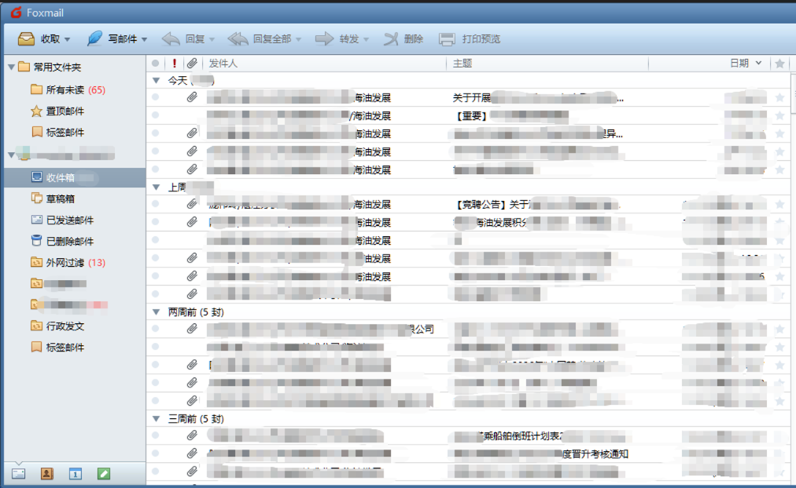
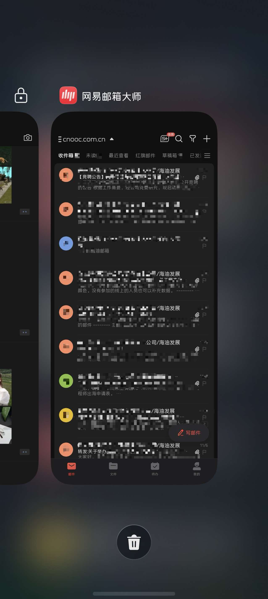

# 海油邮箱助手

适用于中国海油企业邮箱的 IMAP / SMTP 动态密码的windows工具，在第三方邮件客户端中配置海油邮箱。

## 为什么做这个工具

鸿蒙还没适配海油邮箱（2027年了），卓易通拉的一批，ios之前用的也很拉，不是没推送，就是无法分享，不如2021年的Outlook
- 后续（计划），再移植海油邮箱（亿邮）

## 适合什么用途

- 在第三方邮箱中配置海油邮箱。

可将海油邮箱接入第三方客户端，下面两张截图分别来自 Foxmail 和网易邮箱大师。

Foxmail：

网易邮箱大师：

## 邮件客户端怎么填（如果需要）

| 设置项 | 填写内容 |
| --- | --- |
| 邮箱地址 | 自己的完整邮箱地址，例如xxxx@cnooc.com.cn |
| 收件协议 | IMAP |
| 收件服务器 | `cmail.cnooc.com.cn` |
| 收件端口 | `993` |
| 收件加密方式 | SSL / TLS |
| 收件用户名 | 完整邮箱地址 |
| 收件密码 | 本工具生成的完整动态密码 |
| 发件协议 | SMTP |
| 发件服务器 | `cmail.cnooc.com.cn` |
| 发件端口 | `465` |
| 发件加密方式 | SSL / TLS |
| 发件服务器身份验证 | 开启；用户名和密码与收件设置一致 |
| 发件地址 / 发件用户名 | 与本次登录、所选邮箱一致的完整邮箱地址 |

## 目前的限制

- **无法获取企业通讯录。** 不能同步组织架构、查找全员联系人；收件人地址需要自行填写，或使用客户端已有的联系人。
- **动态密码不保证长期有效。** 失效后需要重新运行工具、完成验证，再更新客户端中的收件和发件密码；目前不支持自动续期。
- **不能替代官方客户端的全部功能。** 本工具只负责生成动态密码，不提供邮件阅读、撰写或其他企业专属功能。
